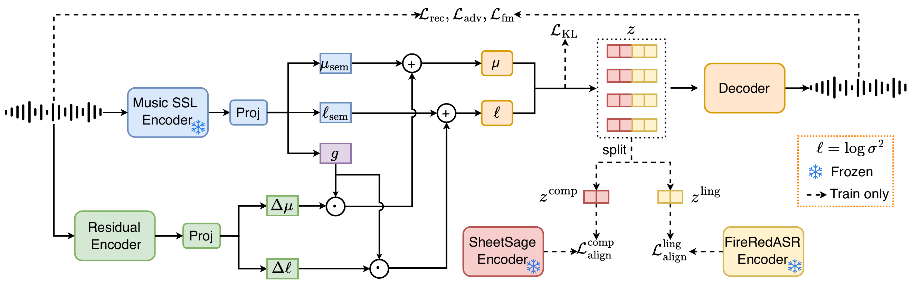

<p align="center">
  
</p>

<h1 align="center">MSVAE</h1>
<p align="center"><strong>Rethinking Musical Semantics in Continuous Latent Spaces</strong></p>
<p align="center">
  <a href="https://aslp-lab.github.io/MSVAE/">Audio demo</a> ·
  <a href="https://huggingface.co/ASLP-lab/MSVAE">Model weights</a> ·
  Paper (coming soon)
</p>

Official inference code for **MSVAE (Music Semantic Variational Autoencoder)**. This release reconstructs stereo music with the Stage II model: it encodes audio at 24 kHz and decodes a 48 kHz stereo waveform.

## 💡 Overview

MSVAE learns a 64-dimensional continuous latent at 25 Hz. A frozen music self-supervised encoder provides its semantic base, while a gated acoustic residual supplies reconstruction detail. During training, two disjoint latent halves are aligned with compositional and linguistic-vocal references. Inference needs the MSVAE checkpoint and the separately loaded MuQ encoder; the training-time alignment encoders are not needed to reconstruct audio.

This repository contains **standard reconstruction inference only**. Training code, downstream generators, and separate latent-half or encoder-path reconstruction tools are outside this release.

### Model architecture

[](assets/msvae-architecture.pdf)

*Click the figure for the full-size PDF. Dashed alignment paths are used only during training.*

## 🎧 Audio demo

Listen to paired originals and reconstructions on the [MSVAE demo page](https://aslp-lab.github.io/MSVAE/). The released Stage II checkpoint produces 48 kHz output from 24 kHz input; frequencies above the input Nyquist limit are inferred by the decoder, not recovered from the original recording.

## 🚀 Getting started

### 1. Set up the environment

Run the commands below from the repository root, which contains `scripts/` and `src/`. Create a Python environment and install the dependencies. For GPU inference, install matching PyTorch and torchaudio builds compatible with your CUDA environment first.

```bash
python3 -m venv .venv
source .venv/bin/activate
python -m pip install -r requirements.txt
```

The inference code has been tested with Python 3.11, PyTorch 2.5.1, and torchaudio 2.5.1. With torchaudio 2.9 or later, audio saving requires a compatible [TorchCodec installation](https://docs.pytorch.org/audio/stable/generated/torchaudio.save.html).

### 2. Load the checkpoints

**MSVAE weights are downloaded automatically when needed.** Inference first looks for `model.pt` in the repository root, or the local path selected by `CKPT_PATH` or `--ckpt-path`. If that file is missing, it checks the Hugging Face cache and then downloads [`model.pt`](https://huggingface.co/ASLP-lab/MSVAE/blob/main/model.pt) from `ASLP-lab/MSVAE`. Automatically downloaded weights remain in the Hugging Face cache; they are not copied into the repository. Set `HF_HOME` or `HF_HUB_CACHE` to choose the cache location.

Optionally, download the checkpoint into the repository root yourself with the Hugging Face CLI:

```bash
hf download ASLP-lab/MSVAE model.pt --local-dir .
```

The checkpoint does **not** include the pretrained [MuQ encoder](https://huggingface.co/OpenMuQ/MuQ-large-msd-iter). The inference code loads it separately, using an existing cached snapshot when available and downloading it on first use otherwise. `--muq-model` can point to a local snapshot. For offline use, provide local weights for both MSVAE and MuQ, or ensure both are already cached.

The model repository also provides [`config.yaml`](https://huggingface.co/ASLP-lab/MSVAE/blob/main/config.yaml) for reference. The script loads `src/config/vae/config.yaml` by default.

If downloads fail through a configured mirror, run with `HF_ENDPOINT=https://huggingface.co`. If Xet downloads stall on your network, use `HF_HUB_DISABLE_XET=1` to select standard HTTP downloads.

### 3. Reconstruct audio

```bash
bash scripts/infer.sh /path/to/input.wav /path/to/output_dir 0
```

The third argument is an optional GPU ID (`0` in this example). It can be omitted even when passing extra flags. When omitted, the script uses `CUDA_VISIBLE_DEVICES` if set, or GPU 0 otherwise; inference falls back to CPU if CUDA is unavailable.

The input may be a single audio file, a directory of audio files, or a UTF-8 text file containing one audio path per line. Directory input reads files directly inside that directory. Relative paths in a text list are resolved from the list's location. Output is 48 kHz stereo WAV with the same duration as the source, up to resampling rounding; mono input is duplicated to stereo.

You can also call the script from another directory. Relative command-line paths and paths supplied through `CKPT_PATH`, `MODEL_CONFIG`, or `PYTHON_BIN` are resolved from your working directory:

```bash
bash /path/to/MSVAE/scripts/infer.sh input.wav ./outputs --latent-mode mean
```

To use a checkpoint stored elsewhere:

```bash
CKPT_PATH=/path/to/model.pt bash scripts/infer.sh /path/to/input.wav /path/to/output_dir 0
```

By default, inference samples the VAE posterior with seed 42. For posterior-mean reconstruction without latent sampling:

```bash
bash scripts/infer.sh /path/to/input.wav /path/to/output_dir --latent-mode mean
```

Long files are processed in overlapping chunks of 128 latent frames with a 32-frame overlap. You can adjust this with `--chunk-size` and `--overlap`, or use `--no-chunked` if the full file fits in memory. `MODEL_CONFIG` overrides the inference YAML, and `PYTHON_BIN` selects a different Python executable.

For example, to use another Python environment and a local checkpoint:

```bash
CKPT_PATH=/path/to/model.pt PYTHON_BIN=/path/to/python \
bash scripts/infer.sh /path/to/input.wav /path/to/output_dir 0
```

To bypass a configured mirror and use standard HTTP downloads:

```bash
HF_ENDPOINT=https://huggingface.co HF_HUB_DISABLE_XET=1 \
bash scripts/infer.sh /path/to/input.wav /path/to/output_dir 0
```

## 📝 Citation

The paper link and BibTeX entry will be added when the paper is publicly available.

## 🙏 Acknowledgements

MSVAE uses [MuQ](https://huggingface.co/OpenMuQ/MuQ-large-msd-iter) as its frozen music encoder. Please follow the terms of the MuQ checkpoint when downloading and using that separate dependency.

The reconstruction decoder and acoustic encoder include components adapted from [BigVGAN](https://github.com/NVIDIA/BigVGAN), [HiFi-GAN](https://github.com/jik876/hifi-gan), and [Descript Audio Codec](https://github.com/descriptinc/descript-audio-codec). Credits and upstream license texts for these components, periodic activations, and resampling helpers are preserved in [incl_licenses](incl_licenses/README.md).

## 💬 Community

If you would like to leave us a message about our work, feel free to email [guobin.ma@mail.nwpu.edu.cn](mailto:guobin.ma@mail.nwpu.edu.cn) or [lxie@nwpu.edu.cn](mailto:lxie@nwpu.edu.cn).

Click either image to view the full-resolution QR code.

| MSVAE WeChat group | Personal WeChat |
| :---: | :---: |
| <a href="assets/Wechat.jpg"></a> | <a href="assets/Bing0.jpg"></a> |

The group QR code in the image expires before October 19, 2026. If it no longer works, please email us for a current invitation.

## 📄 License

The original MSVAE inference code is released under the [Apache-2.0 License](LICENSE). Third-party code retains its upstream licenses and copyright notices; see [incl_licenses](incl_licenses/README.md). Pretrained model weights are governed by the terms stated in their respective model repositories.
